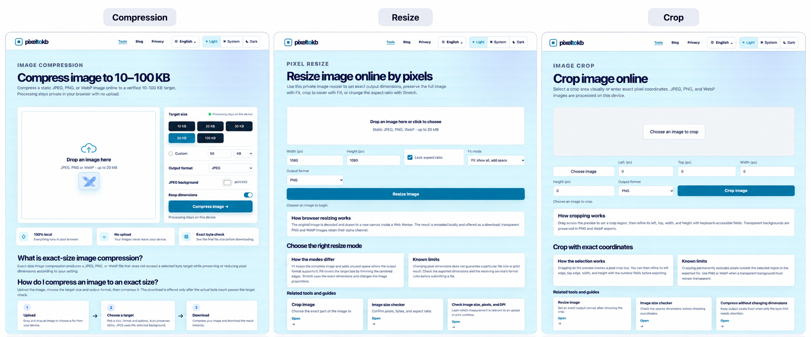

# PixelToKB

[PixelToKB](https://www.pixeltokb.com) is a privacy-first set of browser-based image tools for preparing, compressing, resizing, cropping, and checking image files. Image processing runs in the browser, so selected files are not uploaded to a PixelToKB server.

## Product introduction

The image below is a partial feature preview of PixelToKB rather than a complete feature list. It highlights three everyday workflows—compressing an image to a target file size, resizing it by exact pixel dimensions, and cropping it by selection or coordinates—while the site also includes PNG optimization, print-size photo preparation, signature-image tools, aspect-ratio and PPI planning, and file inspection.

PixelToKB is designed for people who need a dependable image file before an upload, form submission, or publishing workflow. The main advantages are straightforward: processing stays in the browser, selected images are not uploaded to a PixelToKB server, no account or cloud storage is required, and the tools expose practical checks such as actual bytes, pixel dimensions, format, transparency, and available DPI metadata. The interface is responsive, available in English, Simplified Chinese, and Traditional Chinese, and keeps the workflow focused on choosing a file, setting a clear target, checking the result, and downloading it.

## Tools by workflow

### Compression

- Exact-size image compression for JPEG, PNG, and WebP
- Lossless PNG optimization for one file or a batch of up to 20 files, with individual or ZIP downloads

### Resizing and cropping

- Pixel-based image resizing with fit, fill, and stretch options
- Visual and coordinate-based image cropping
- Physical photo resizing in millimetres or inches with verified DPI metadata
- Aspect-ratio and PPI calculators for planning dimensions and print output

### Signatures and form images

- Signature image resizing with crop and pixel controls
- Signature image compression for a selected file-size limit
- Image size checking before an upload or form submission

### Inspection

- Exact file size in bytes, KB, and KiB
- Pixel dimensions, format, aspect ratio, transparency, and available DPI metadata
- DPI metadata checking when a file contains print-resolution information

## Planned image workflows

The next product expansion remains focused on local image preparation:

- Background removal with transparent-background controls
- Photo and signature composition
- A4 and Letter print sheets with a calibration ruler
- Controlled image enlargement with output validation
- Additional interface languages after complete translation and review

## Privacy by design

PixelToKB is designed for local, in-browser processing. The published tools do not upload selected images, create public result URLs, or require an account for image processing. See the [Privacy Policy](https://www.pixeltokb.com/privacy/) and [Cookies Policy](https://www.pixeltokb.com/cookies/) for the published data and cookie information.

## Product information

- Website: [www.pixeltokb.com](https://www.pixeltokb.com)
- Operator: PixelTokb
- Support: [support@pixeltokb.com](mailto:support@pixeltokb.com)
- Information: [About](https://www.pixeltokb.com/about/), [Contact](https://www.pixeltokb.com/contact/), [Terms](https://www.pixeltokb.com/terms/), and [Editorial Policy](https://www.pixeltokb.com/editorial-policy/)
