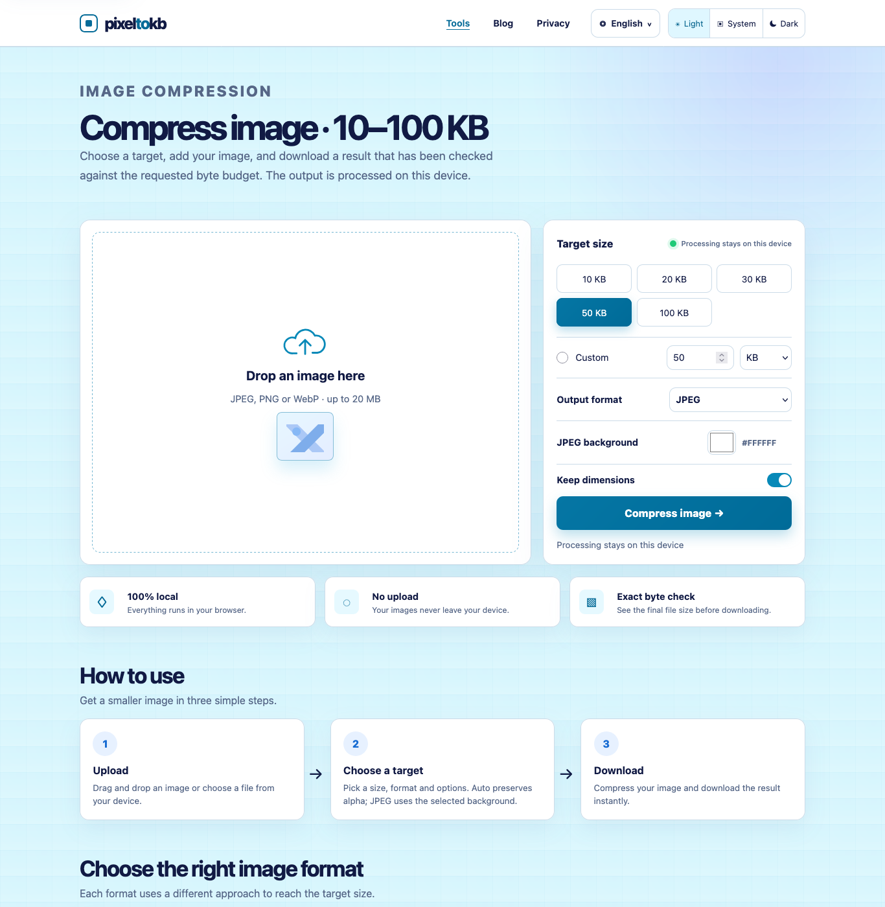
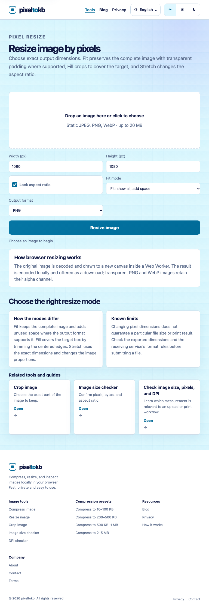
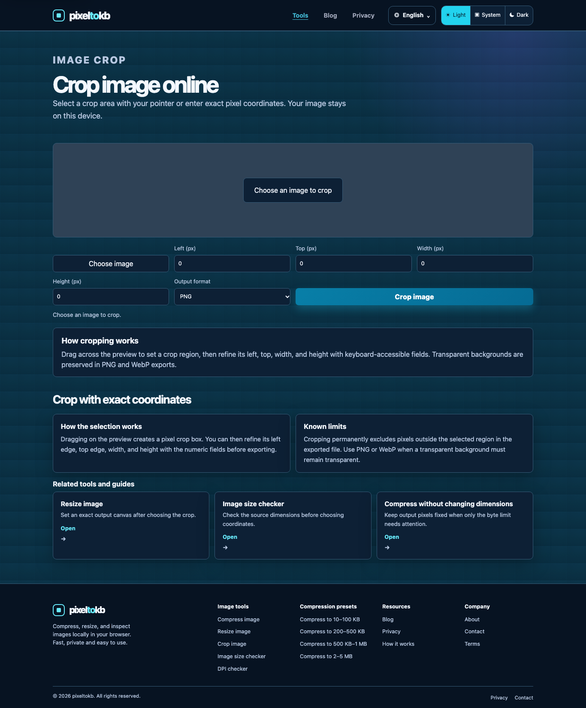

# PixelToKB

[PixelToKB](https://www.pixeltokb.com) is a privacy-first collection of browser-based image tools. Images are processed locally in the browser and are not uploaded to a PixelToKB server.

## Product preview

### Exact-size image compression

### Image resizing

### Image cropping

## Image tools

- Exact-size image compression
- Image resizing
- Image cropping
- Image size checking
- Image DPI checking

## Coming next

- PNG optimization
- Signature image preparation
- Physical photo resizing
- Image dimension presets
- Print size and PPI calculation

## Privacy

Image processing takes place on the user's device. Selected images are not uploaded or assigned a public result URL. Read the published policies and product information at [www.pixeltokb.com](https://www.pixeltokb.com).

## Operator

PixelToKB is operated and reviewed by PixelTokb. Contact: [Support@piexltokb.com](mailto:Support@piexltokb.com).
